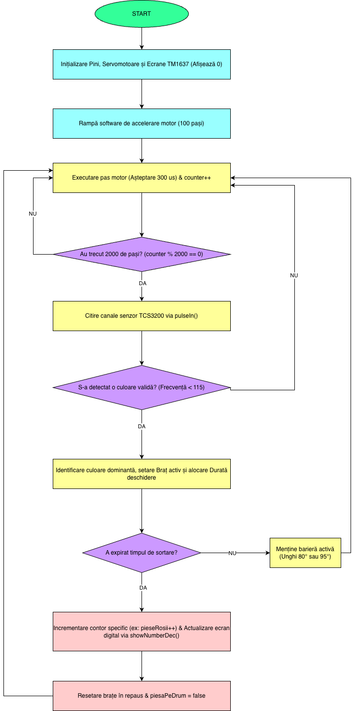

# sistem-sortare-mecatronic
Sistem mecatronic de sortare automată cu bandă rulantă și control Arduino

Proiect practic de inginerie: linie automată cu bandă rulantă, sortare după culoare și comandă pe microcontroler.

🎬 Video Demo
* [Vezi cum funcționează pe YouTube Shorts](https://youtube.com/shorts/ZjLNhRZdgmU?si=tnLGCBKNV0QCVmAr)

📸 Schemă Funcțională

 🛠️ Componente & Tehnologii
* **Microcontroler:** Arduino (ATmega328P)
* **Senzor:** Senzor optic de culoare (RGB)
* **Actuatoare:** Servomotor (deviere piese) + motor pas cu pas (bandă rulantă)
* **Software:** C/C++ (Arduino IDE)
* **Mecanică:** Piese proiectate CAD și asamblare fizică

 ⚙️ Ce face proiectul
1. Detectează culoarea piesei în mișcare pe bandă.
2. Procesează datele pe microcontroler și decide traseul.
3. Acționează servomotorul și sortează piesa la momentul potrivit.
4. Sistemul a fost calibrat și testat fizic pentru precizie.

---

## 📁 Fișiere
* `CODBANDAFINAL.ino` – Codul sursă complet.
* `DIAGRAMAEXCELENTA.png` – Schema logică a sistemului.
* `IMAGINI/` – Poze din timpul realizării și cu macheta finală.
